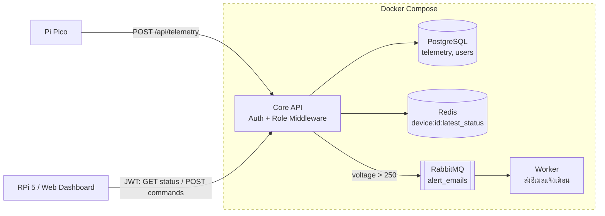

# Workshop 10: Architecture Board

## คำถาม "What if" ที่ควรเตรียม
| คำถาม | สถานะปัจจุบัน | Action (Issue) |
|---|---|---|
| Pi Pico ยิงขยะ 1,000 ครั้ง/วินาที | ยังไม่มี Rate Limiting | security: เพิ่ม express-rate-limit |
| ไฟดับ ข้อความในคิวหายไหม | คิว durable + message persistent ไม่หาย | - |
| ยิงตรงเข้าพอร์ต 5432 ได้ไหม | ได้ เพราะ compose เปิดพอร์ต | security: ลบ ports ของ postgres/redis |
| Redis ล่ม | ยังไม่มี fallback | refactor: fallback ไปอ่าน DB |
| JSON ผิดรูปแบบ | ได้ 400 จาก Express | test: เพิ่ม unit test เคสนี้ |
